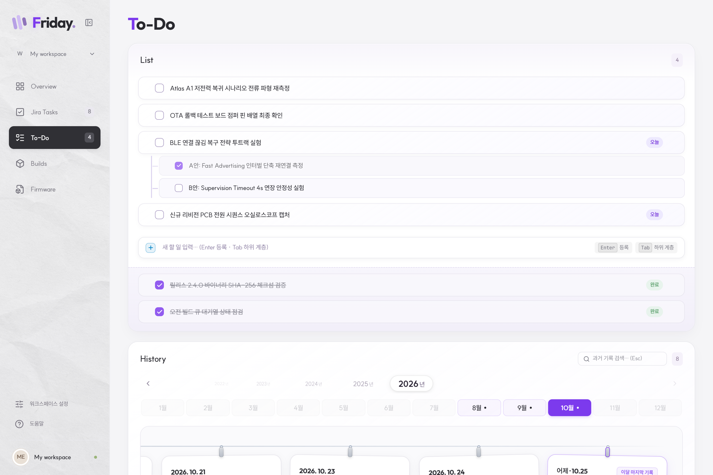
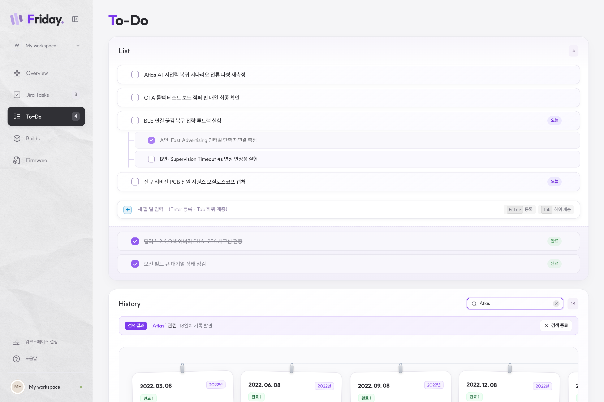

# Friday · Personal Dashboard

Windows 11 환경을 위한 엔지니어링 개인 업무 대시보드입니다.  
불필요한 부제나 장황한 안내 문구 없이 **직관적인 레이아웃과 카드 위계**로 정보를 전달하며, 인위적인 사이버 네온 컬러를 배제한 **물리적 페이퍼 질감과 톤다운 앤틱 브라스/골드** 감성을 제공합니다.

---

## 주요 기능 및 화면

### 1. Overview (대시보드 홈)
사용자의 현재 작업 상태를 한눈에 조망할 수 있는 중앙 허브입니다.


- **파노라마 천체 히어로**: 시간대(새벽/아침/오후/저녁/밤)에 따라 서정적으로 변화하는 태양/달과 산맥 배경 일러스트.
- **균형 잡힌 Bento 그리드**: 좌측 To-Do 카드와 우측 Builds/Firmware 카드의 하단 끝선을 완벽히 일치시키고, 항목이 늘어나도 외부 레이아웃을 깨뜨리지 않고 내부 스크롤바가 생성되도록 고정.
- **간결해진 핵심 업무 목록**: 하단에 전체 폭으로 Jira 업무를 배치하고, 불필요한 필터 버튼을 제거하여 직관적인 확인 지원.

---

### 2. To-Do & History (할 일 및 빨랫줄 히스토리)
생산적인 일일 체크리스트와 아날로그 감성의 과거 기록 보관소입니다.



- **키보드 중심 워크플로우**: `Enter`로 즉시 등록, `Tab`과 `Shift+Tab`으로 자유로운 하위 및 하위의 하위 계층화 지원.
- **정돈된 인터랙션**: 마우스 드래그 앤 드롭 순서 변경, 행 호버 시에만 나타나는 삭제 버튼, 완료 항목의 취소선을 배제한 깨끗한 가독성.
- **빨랫줄 메모지 타임라인**: 와이어에 메탈릭 티타늄 클립으로 매달린 부드러운 곡률(`border-radius: 16px`)의 일별 메모 카드.
- **연/월 피커**: 과거 연도와 월별 기록을 자유롭게 전환하며, 데이터가 없는 월도 깔끔한 알약 컨테이너로 시각적 일관성 유지.

---

### 3. History Search (스마트 필터링 타임라인)
과거의 방대한 누적 일별 기록을 신속하게 찾아내는 타임라인 검색 기능입니다.



- **캡슐형 슬림 검색 바**: History 헤더 우측의 컴팩트 인풋 (`Esc` 키 및 `✕` 원클릭 초기화 지원).
- **검색 상태 바 전환**: 검색어 입력 즉시 연/월 피커 자리에 `검색 상태 바`가 나타나 일치 기록 일수 표시 및 검색 종료 버튼 제공.
- **키워드 하이라이트**: 메모 카드 내 매칭 텍스트에 테마 맞춤 하이라이트(`mark.history-search-match`) 적용.
- **다년도 식별 뱃지**: 검색 결과 카드 헤더에 해당 연도 뱃지(`2022년`, `2026년` 등)를 자동 표기하여 직관적인 시점 파악 가능.

---

### 4. Jira Tasks (워크플로우 칸반 보드)
내게 할당된 티켓을 워크플로우 단계별로 관리합니다.


- **4단계 컬럼**: `Open` → `Progress` → `Resolved` → `Closed`
- **글라스 티켓 카드**: 드래그 앤 드롭 이동, 우선순위 배지, 상세 조회 모달.
- **로컬 전용 숨김/복원**: 작업 완료 후 집중을 위해 보드에서 임시로 숨기거나 언제든 복원 가능.

---

### 5. Dual Themes (Daylight & Midnight)
눈의 피로도를 낮추고 작업 몰입도를 높이는 두 가지 완성형 테마를 지원합니다.


- **Daylight (라이트 모드)**: 은은한 종이 질감(`sidebar-paper.png`) 배경과 부드러운 라벤더 포인트.
- **Midnight (다크 모드)**: 차분한 딥 차콜 레이어와 고급스러운 톤다운 앤틱 브라스/골드(`--brand-f-accent: #cca04b`), 테라코타 러스트 이월 배지(`rgba(215, 85, 35, 0.15)`).

---

## 기술 스택

- **Platform**: Tauri 2 (Rust) + Windows 11 WebView2
- **Frontend**: React 19, TypeScript, Vite
- **Styling**: Tailwind CSS, CSS Semantic Tokens, Web Animations API
- **Primitives**: Radix UI Dialog, Lucide Icons
- **Testing**: Vitest (Unit), Playwright (E2E)

---

## 실행 및 검증

### 브라우저 환경 실행
```powershell
npm run dev
# http://127.0.0.1:1420
```

*대량 히스토리(약 12,400건) 미리보기: `http://127.0.0.1:1420/?todoHistory=large`*

### 데스크톱(Tauri) 앱 실행
```powershell
npm run tauri -- dev
```

### 테스트 및 검증
```powershell
# Vitest 도메인/유틸 단위 테스트 (36 passed)
npm test

# Playwright E2E UI 테스트 (32 passed)
npm run test:ui

# 프로덕션 빌드 검증
npm run build
```

---

## 관련 문서

- [시스템 아키텍처 가이드](docs/architecture.md)
- [디자인 시스템 및 테마 토큰](docs/theme-and-design-system.md)
- [Overview 레이아웃 계획](docs/overview-layout-plan.md)
- [개발자 가이드 및 기여 방법](docs/contributing.md)
- [사내 시스템 연동 핸드오프](docs/company-handoff.md)
- [전체 검증 기록](docs/verification.md)
