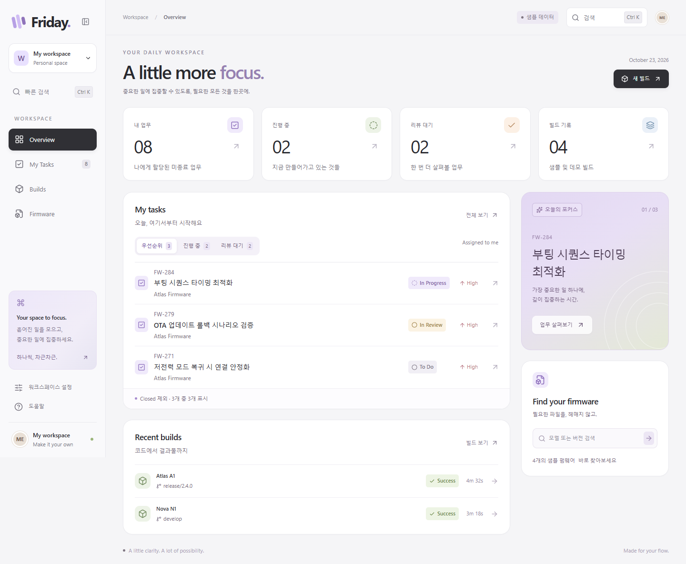
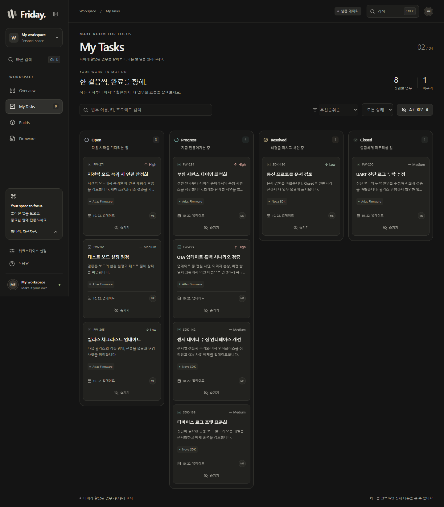
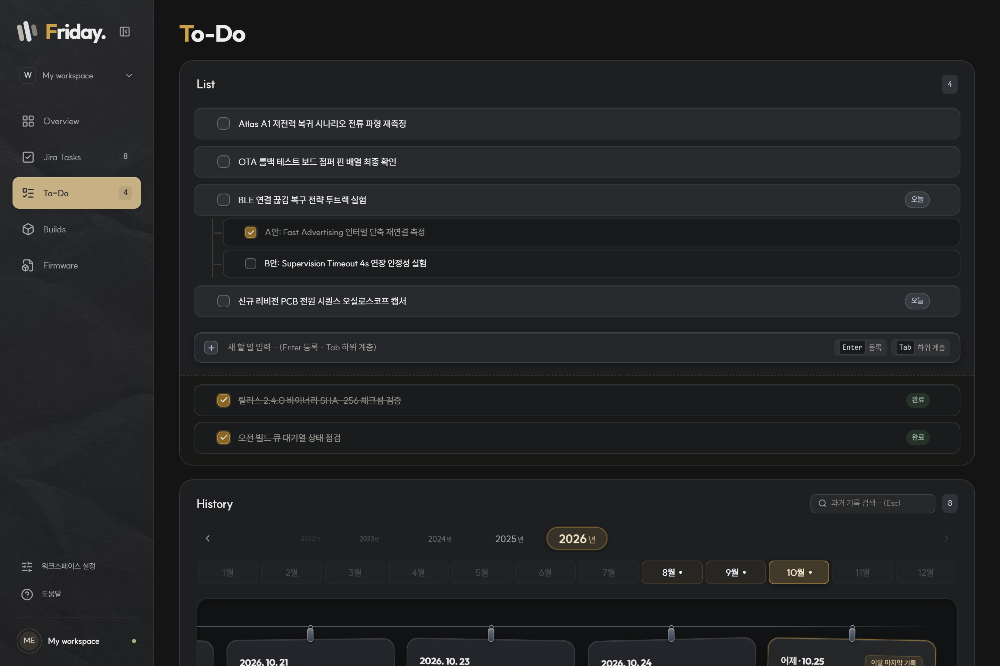

# Friday · Personal Dashboard

Windows 11용 개인 업무 대시보드입니다. Jira 업무, 빌드, 펌웨어를 연결하기 전에 **UI/UX를 먼저 완성한 샘플 앱**입니다.



## UI/UX 원칙

- **불필요한 세컨더리 라벨이나 설명을 피한다. 레이아웃으로 설명을 전달한다.**
- 부제, 영문 슬로건(`eyebrow`), 중복 안내 문구 대신 카드의 비례·정렬·여백·구분감만으로 화면의 위계와 기능을 직관적으로 전달합니다.

## 구현된 화면

- **Overview** — 내 업무 요약, 우선순위 업무, 남아있는 TODO, 최근 빌드, 빠른 펌웨어 검색
- **My Tasks** — 내 업무를 Open / Progress / Resolved / Closed 보드로 표시(티켓·제목 중심 글라스 카드), 검색·정렬·상세 패널·로컬 숨기기/복원
- **To-Do** — 3-Way 뷰 모드(전체 뷰 / 할 일 집중 / 히스토리), 드래그 앤 드롭 정렬 핸들, 키보드 중심(Enter 등록, Tab 하위 계층화) 입력, 미완료 자동 이월 및 테라코타 러스트 배지, 호버 시 노출되는 삭제 액션. 하단 히스토리는 접기/펼치기 및 모던 타임라인 카드와 좌우 부드러운 스크롤 내비게이션을 제공합니다.
- **Builds** — 대상/브랜치/프로필 입력, 확인 후 데모 대기열에 한 번 추가, 이력 상세
- **Firmware** — 모델·버전·브랜치·파일명 검색, 상세 정보, 실제 클립보드 복사
- **공통** — `Ctrl+K` 검색, 방향키/Enter 선택, Escape 닫기, 메뉴 접기, 움직임 줄이기

데이터와 경로는 모두 예시입니다. 실제 회사 API 호출, 빌드 실행, 파일 검색은 아직 없습니다. 데모 빌드는 재실행하면 초기화되고 테마·숨긴 업무·TODO는 유지됩니다. 숨기기는 Jira 상태를 바꾸지 않습니다.



## 기술 구성

Tauri 2 / Rust · React / TypeScript / Vite · Tailwind CSS / CSS tokens · Radix Dialog · Lucide

추가 애니메이션 프레임워크 없이 CSS와 Web Animations API로 구현했습니다. 반복 애니메이션이나 백그라운드 폴링은 없습니다.

## 실행

필수: Windows 11, Node.js 24 LTS, Rust stable MSVC toolchain, Visual Studio C++ Build Tools, WebView2 Runtime. UI 테스트는 Microsoft Edge를 사용합니다.

```powershell
npm ci
npm run tauri -- dev
```

브라우저에서 UI만 확인:

```powershell
npm run dev
# http://127.0.0.1:1420
```

대량 To-Do 히스토리 미리보기: `http://127.0.0.1:1420/?todoHistory=large`. 2020년 1월 1일부터 어제까지 하루 3~7개의 완료 기록을 기존 샘플에 추가합니다. 2026년 10월 기준 7개 연도, 82개월, 약 12,400개 기록이며, 이 주소에서 편집한 내용은 저장하지 않아 기존 할 일 데이터에 영향을 주지 않습니다.

개발 서버는 로컬 전용이며 포트가 사용 중이면 종료합니다. `tauri dev`가 개발 서버를 실행하므로 위 두 명령을 동시에 실행하지 마세요.

## 빌드와 검증

```powershell
npm test
npm run test:ui
npm run build
cargo fmt --manifest-path src-tauri/Cargo.toml -- --check
npm run tauri -- build --no-bundle
```

실행 파일: `src-tauri/target/release/personal-dashboard.exe`

설치 프로그램·코드 서명·자동 업데이트는 이번 범위에 포함하지 않습니다. 브라우저 화면 캡처는 개발 서버 실행 후 `node scripts/capture-ui.mjs`로 생성합니다. 캡처와 테스트 로그는 Git에서 제외된 `tmp/`에 저장합니다.

## 회사에서 이어서 개발하기

워크스페이스 설정 → **화면 테마**에서 Daylight / Midnight를 선택할 수 있습니다. 테마 선택은 이 장치에 저장되며 다음 실행에도 적용됩니다. 저장이 차단된 환경에서는 이번 실행에만 적용하고 알림을 표시합니다.

Midnight는 차콜·스톤·아이보리 중심의 중성 팔레트 위에 톤다운된 앤틱 브라스/골드(`--brand-f-accent: #cca04b`)와 테라코타 러스트를 결합하여 AI 틱한 사이버 네온 컬러를 배제한 차분한 감성을 제공합니다. `Ctrl K` 검색은 업무·빌드·펌웨어를 분류해 표시하며 방향키로 이동합니다. 설정의 움직임 줄이기 스위치는 클릭 또는 Space로 전환할 수 있습니다.



- [시스템 아키텍처 가이드](docs/architecture.md)
- [개발자 가이드 및 워크플로우](docs/contributing.md)
- [디자인 시스템 및 테마 토큰](docs/theme-and-design-system.md)
- [사내 환경 연동 가이드](docs/company-handoff.md)
- [검증 기록](docs/verification.md)
- [승인된 설계 사양](docs/superpowers/specs/2026-10-22-personal-dashboard-design.md)
- [디자인 출처 및 라이선스](THIRD_PARTY_NOTICES.md)

실제 UI 확인과 프레임 측정은 최종 Windows 장비에서 다시 수행하세요. 프레임과 리소스 사용량은 WebView2 버전·해상도·데이터량·하드웨어에 따라 달라집니다.
