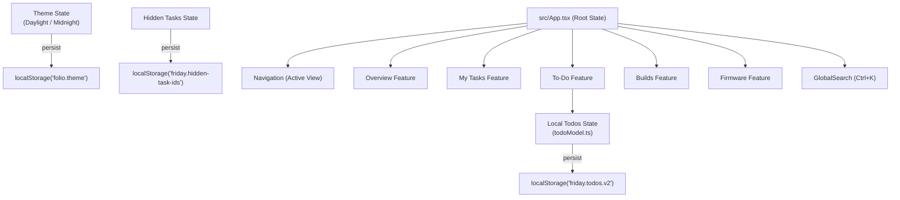

# 시스템 아키텍처 (System Architecture)

Friday(Personal Dashboard)는 Windows 11 환경을 타깃으로 하는 데스크톱 개인 엔지니어링 대시보드 애플리케이션입니다.
본 문서는 프로젝트의 전체 구조, 상태 관리 흐름, UI/UX 아키텍처 및 Tauri 네이티브 바운더리를 설명합니다.

---

## 1. 기술 스택 개요

| 레이어 | 기술 | 역할 |
|---|---|---|
| **데스크톱 호스트** | Tauri 2 (Rust) | 네이티브 윈도우 생성, 생명주기 관리, 향후 사내 시스템 및 로컬 파일시스템/인증 통합 바운더리 |
| **렌더러 엔진** | Microsoft WebView2 | Windows 11 네이티브 WebView 기반 렌더링 |
| **프런트엔드 코어** | React 19, TypeScript | 컴포넌트 기반 UI 구성 및 상태 관리 |
| **빌드 & 번들러** | Vite 8, Rolldown runtime | 초고속 HMR 개발 서버 및 경량 프로덕션 번들링 |
| **스타일링** | Tailwind CSS v4, CSS Variables | 시맨틱 디자인 토큰 기반 라이트/다크(Midnight) 테마 |
| **접근성 UI 프리미티브** | Radix UI (`@radix-ui/react-dialog`) | 키보드 내비게이션, 포커스 트랩 및 복귀를 보장하는 모달 다이얼로그 |
| **아이콘** | Lucide React | 일관된 모던 UI 아이콘 셋 |
| **테스트 프레임워크** | Vitest, Playwright | 단위 도메인 로직 검증 및 헤드리스 브라우저 E2E UI 검증 |

---

## 2. 디렉터리 구조

```text
PersonalDashboard/
├── docs/                        # 개발 문서 및 사내 인계 가이드
│   ├── architecture.md          # [현재 문서] 시스템 아키텍처
│   ├── contributing.md          # 개발 가이드 및 워크플로우
│   ├── theme-and-design-system.md # 디자인 시스템 및 컬러 토큰
│   ├── company-handoff.md       # 사내 실시스템 연동 가이드
│   ├── verification.md          # 회귀 및 품질 검증 기록
│   └── assets/                  # 문서용 스크린샷 자산
├── src/                         # 프런트엔드 애플리케이션 소스
│   ├── components/              # 화면 공통 컴포넌트
│   │   ├── GlobalSearch.tsx     # Ctrl+K 전역 검색 모달
│   │   └── ui.tsx               # 모달, 다이얼로그 래퍼 등 UI 공통 컴포넌트
│   ├── data/                    # 도메인 모델 및 샘플 데이터
│   │   ├── model.ts             # 핵심 도메인 타입 정의 (Task, Build, Firmware 등)
│   │   └── demo.ts              # 가상 개발용 목업 데이터
│   ├── features/                # 도메인별 기능 모듈
│   │   ├── overview/            # 통합 대시보드 요약 화면
│   │   ├── tasks/               # Jira 스타일 워크플로우 업무 보드 (Open/Progress/Resolved/Closed)
│   │   │   ├── Tasks.tsx
│   │   │   ├── filter.ts        # 업무 필터링 및 정렬 로직
│   │   │   └── useBoardMotion.ts# 카드 진입 및 위치 이동 FLIP 애니메이션
│   │   ├── todos/               # 일일 체크리스트 및 과거 히스토리 타임라인
│   │   │   ├── Todos.tsx        # To-Do 메인 화면 (3-Way 뷰 모드 지원)
│   │   │   ├── todoModel.ts     # 할 일 생성, 완료, 이월, 드래그 순서 재정렬 로직
│   │   │   ├── demoHistory.ts   # 과거 일자별 히스토리 데이터 및 대량 목업
│   │   │   ├── HistoryPeriodPicker.tsx # 연도/월 선택 그리드 바
│   │   │   └── HistoryNoteItems.tsx    # 과거 히스토리 기록 카드 목록
│   │   ├── builds/              # 빌드 대기열 및 시뮬레이션
│   │   │   ├── Builds.tsx
│   │   │   └── validation.ts    # 빌드 제출 폼 검증
│   │   └── firmware/            # 펌웨어 아티팩트 검색 및 복사
│   │       ├── Firmware.tsx
│   │       └── filter.ts        # 펌웨어 필터/검색 로직
│   ├── App.tsx                  # 최상위 애플리케이션 진입점 및 전역 상태 소유
│   ├── main.tsx                 # React 루트 렌더러
│   ├── styles.css               # 기본 유틸리티 및 레이아웃 스타일
│   ├── theme.css                # Daylight / Midnight 컬러 토큰 및 테마 오버라이드
│   └── task-board.css           # 업무 보드 및 To-Do 특화 레이아웃 스타일
├── src-tauri/                   # Tauri Rust 네이티브 백엔드
│   ├── Cargo.toml               # Rust 의존성 매니페스트
│   ├── tauri.conf.json          # Tauri 창 설정 및 보안 권한 구성
│   └── src/
│       └── main.rs              # 윈도우 인스턴스 초기화 및 핸들러
├── tests/                       # 자동화 테스트 슈트
│   ├── domain.test.ts           # Vitest 도메인 단위 테스트
│   └── ui/                      # Playwright E2E UI 인터랙션 테스트
└── scripts/                     # 개발 자동화 및 캡처 스크립트
```

---

## 3. 상태 관리 및 데이터 흐름



### 3.1 상태 호이스팅 (State Hoisting) 원칙
- **전역 화면 상태 (`App.tsx`)**: 네비게이션 현재 탭, 전역 검색창 열림 여부, 워크스페이스 설정 다이얼로그, 시뮬레이션 빌드 대기열 상태, 로컬 숨김 처리된 태스크 ID 목록(`hiddenTaskIds`), 다크/라이트 테마(`theme`)를 소유합니다.
- **도메인 격리 상태**:
  - `Tasks.tsx`: 검색어 필터, 정렬 기준, 상세 패널 선택 이슈 ID 등은 태스크 화면 내부에서 관리됩니다.
  - `Todos.tsx`: 일일 할 일 목록 및 과거 히스토리 뷰 모드(`all` | `tasks-only` | `history-only`), 타임라인 접기/펼치기 상태는 독립적으로 관리됩니다.

### 3.2 로컬 영속성 및 Fallback 안전성
- 브라우저 보안 정책이나 WebView2 격리 환경으로 인해 `localStorage` 접근이 차단(`QuotaExceededError`, `SecurityError`)될 경우 앱이 충돌하지 않도록 모든 영속화 로직은 `try/catch`로 래핑되어 있으며, 실패 시 인메모리 세션 폴백을 제공합니다.

---

## 4. UI/UX 및 디자인 시스템 철학

### 4.1 "레이아웃으로 설명을 전달한다"
- **불필요한 세컨더리 라벨이나 부제(eyebrow), 영문 장식 문구를 지양합니다.**
- 사용자가 버튼 라벨이나 안내문을 읽지 않고도, 카드의 형태, 대비, 그리드 정렬, 여백(Spacing), 시각적 위계만으로 조작 방식을 직관적으로 이해할 수 있도록 설계되었습니다.

### 4.2 Anti-AI Aesthetic (AI 틱한 클리셰 배제)
- 생성형 AI가 대량 생성하는 전형적인 네온 보라빛 그라데이션, 번쩍이는 사이버 시안 글로우 효과를 완전히 배제했습니다.
- 다크 모드(Midnight)에서는 실제 하드웨어 엔지니어링 및 랩 작업실에 어울리는 **따뜻한 중성 차콜 캔버스(`var(--surface)`)** 위에 **톤다운된 앤틱 브라스/골드 (`#cca04b`)**를 핵심 악센트로 채택했습니다.
- 이월된 미완료 할 일은 차분한 테라코타 러스트(`--color-carried`) 배지로 구분하여 작업 우선순위를 명확히 합니다.

### 4.3 경량 인터랙션 & 0% 유휴 오버헤드
- 외부 거대 애니메이션 라이브러리(Framer Motion 등)를 배제하고 **순수 CSS Transition** 및 **Web Animations API**만을 활용합니다.
- 상시 실행되는 `requestAnimationFrame` 루프나 불필요한 백그라운드 폴링 타이머가 없으므로 유휴 상태(Idle) CPU 사용량은 0%를 유지합니다.
- OS의 `prefers-reduced-motion` 및 앱 내 설정의 "움직임 줄이기" 옵션을 최우선으로 존중합니다.

---

## 5. 네이티브 바운더리 및 연동 확장성

- 현재 UI 프로토타입 단계에서는 `src-tauri/src/main.rs`가 창 관리(생명주기, 크기, 타이틀바)만을 수행합니다.
- 사내 환경에 연동할 때는 프런트엔드 코드를 대규모로 뜯어고칠 필요 없이, `src/data/demo.ts` 및 각 피처의 API 공급 계층(`filter.ts`, `todoModel.ts`)을 Rust의 `invoke()` Tauri IPC 명령으로 치환하도록 설계되었습니다.
- 상세한 사내 연동 단계와 주의사항은 [회사 환경 연동 가이드](file:///C:/dev/PersonalDashboard/docs/company-handoff.md)를 참고하십시오.
