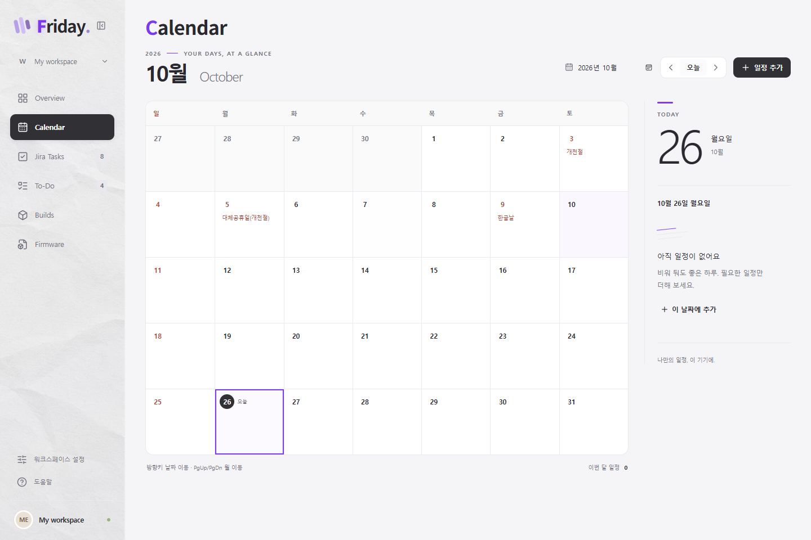
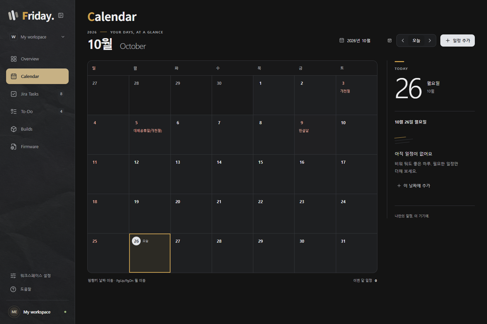

# Calendar

## 설계와 범위

Overview 바로 아래에 월간 Calendar를 둔다. 공휴일 JSON을 번들에 포함하고 개인 일정은 해당 PC의 WebView2 localStorage에 저장한다. API 키, 외부 요청, 추가 패키지는 없다. 일정은 제목·날짜·종일 또는 시작/종료 시간·메모를 가진 단일 날짜 일정이다. 반복, 여러 날짜 일정, 알림, 클라우드 동기화는 이번 범위가 아니다.

공개 서버 자동 갱신은 최신 데이터 확보에 유리하지만 회사 PC의 외부 통신을 발생시킨다. 사용자가 선택한 내장 방식은 조회 시 통신이 없고 오프라인으로 동작하며, 공휴일 변경 시 검토한 데이터를 앱 업데이트로 배포한다.

## 화면과 상호작용

- 기존 Daylight/Midnight의 표면·문자·상태 색상과 Lucide 아이콘을 사용한다. 큰 월 제목, 얇은 격자, 작은 악센트, 선택 날짜의 큰 숫자로 담백한 탁상 달력 느낌을 준다.
- 왼쪽 월간 달력, 오른쪽 선택일 일정. 좁은 창에서는 일정 영역을 아래로 내린다.
- 이전/다음 달, 오늘, 월 직접 선택. 날짜 선택 시 오른쪽에 공휴일과 모든 개인 일정을 표시한다.
- 한 칸에는 일정 두 개까지만 보여주고 나머지는 `+N개`로 표시한다. 공휴일이 있는 날은 공휴일 이름을 두 줄까지 보여주고 개인 일정은 한 개를 미리 보여준다. 날짜를 선택하면 전체 목록을 볼 수 있다.
- 큰 창에서는 달력 높이가 창 높이에 맞춰 늘어난다. 날짜는 15px, 공휴일·일정 미리보기는 12px로 표시한다. 상단 슬로건, 선택일의 중복 날짜 제목, 로컬 저장 장식 문구는 제거하고 연도·월·선택일·일정 순서로 정보 위계를 정리한다.
- 방향키로 날짜/주 이동, Home/End로 주의 처음/끝, PageUp/PageDown으로 월 이동. Tab은 선택 날짜 한 곳만 경유한다. Enter/Space는 날짜 선택이다.
- 일정 추가·수정은 기존 Radix 모달을 사용한다. 저장 실패 시 편집 내용을 유지하며 실패를 표시한다. 삭제는 확인 후 수행한다.

## 참고한 UX

- [FullCalendar moreLinkClick](https://fullcalendar.io/docs/moreLinkClick): 혼잡한 날짜의 요약과 전체 일정 접근. 팝오버 대신 지속적인 우측 일정 영역에 적용한다.
- [WAI-ARIA APG Date Picker](https://www.w3.org/WAI/ARIA/apg/patterns/dialog-modal/examples/datepicker-dialog/): 단일 Tab 진입점, 방향키·월 이동, 월 제목 live region.
- [FullCalendar accessibility](https://fullcalendar.io/docs/accessibility): 버튼과 일정에 명확한 접근성 이름을 부여한다.

레퍼런스의 인터랙션 원칙만 직접 구현하며 라이브러리 코드나 외부 폰트를 추가하지 않는다.

## 데이터와 보안

- 개인 일정 저장 키: `friday.calendar.v1`. JSON 버전과 각 필드를 검증하며 읽기 실패/손상 시 수정 기능을 잠가 기존 내용을 덮어쓰지 않는다.
- 저장은 성공한 뒤에만 화면 상태에 반영한다. Web Locks로 창 간 저장을 직렬화하고 잠금 안에서 원본을 비교한다. 다른 창의 변경과 충돌하면 기존 일정을 보호하고 입력 내용을 새 일정으로 저장하는 선택지를 제공한다. Web Locks를 지원하지 않는 환경에서는 저장 실패를 표시하며 비보호 쓰기로 우회하지 않는다.
- 로컬 저장은 앱 자체 암호화가 아니며 같은 OS 계정 접근, PC 백업/보안 정책의 영향을 받는다. WebView2 데이터 삭제 시 일정도 사라진다. 이 기능의 무통신 설계가 앱 전체 보안 인증이나 사내 승인을 의미하지는 않는다.
- 기존 `index.html`에는 Google Fonts/jsDelivr 폰트 링크가 있다. 웹 개발 모드에서 실제 요청을 확인했으며 Calendar 변경과 별개인 기존 동작이다. 외부 요청 차단 환경에서도 Calendar를 검증한다. 회사 배포 전 앱 전체 무통신이 필요하면 해당 폰트의 로컬 번들링/링크 제거를 별도로 검토해야 한다. 프로덕션 CSP는 기존 self-only 정책을 유지한다.
- 공휴일: [hyunbinseo/holidays-kr](https://github.com/hyunbinseo/holidays-kr)의 공개 JSON 스냅샷. 출처·범위·SHA-256은 `src/features/calendar/holidays/README.md`, 라이선스는 `THIRD_PARTY_NOTICES.md` 및 배포 에셋에 보존한다.
- 데이터 범위 밖의 연도는 공휴일 미제공 안내를 표시한다. 공휴일이 없다고 단정하지 않는다. 개인 일정은 계속 사용할 수 있다.

## 갱신 절차

개발 환경에서 원본 JSON을 내려받고 날짜·명칭·연도 범위를 검토한다. 변경된 공휴일을 공식 월력요항과 대조한 뒤 `korea.json`과 스냅샷 메타데이터를 갱신한다. 런타임 다운로드나 자동 갱신은 없다.

## 검증

`npm test`, `npm run test:ui -- --workers=1`, `npm run build`, Rust format과 네이티브 빌드 후 별도 WebView2 프로필에서 Calendar의 저장/재시작/테마/화면 크기를 확인한다. 실제 실행 결과는 `verification.md`에 기록한다.

전용 네이티브 스모크: `node scripts/native-calendar-smoke.mjs` (기존 네이티브 검증과 같은 포트 9227, 별도 프로필 필수). 테스트 일정을 생성·삭제하며 사용자 프로필에서는 실행하지 않는다.

### 배경 선택

우측 일정 패널 하단의 이전/다음 버튼으로 8종 배경을 순환 선택한다. 처음에는 날짜에 맞는 계절 배경이 표시된다. 직접 선택한 배경은 Calendar 화면을 열어 둔 동안 유지되고, 날짜와 일정 데이터는 변경하지 않는다. 별도 저장이나 외부 이미지 요청은 없다.
